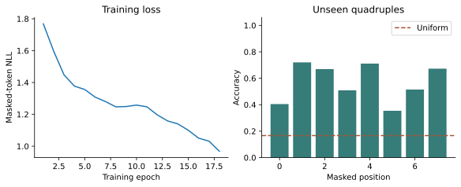

# Bidirectional masked-token encoder

A sequence contains four symbols followed by a second copy of the four. After hiding one symbol, can a bidirectional encoder retrieve its partner?

The model adds learned positions to token embeddings and trains only on the hidden site. This small masked language modelling task isolates bidirectional context. The original BERT training recipe also used different corruption choices and natural-language data.

[Worked notebook](bidirectional_masked_token_encoder.ipynb) · [Python script](bidirectional_masked_token_encoder.py)

## Separate the token combinations

All 6⁴ quadruples are enumerated before the split. Both copies of a quadruple belong to the same example.

## Test each position

Score each held-out quadruple eight times, once at every masked position. The uniform baseline assigns probability 1/6 to the correct symbol.

## Results from the recorded run

| Masked site | Examples | Test accuracy | Test NLL (nats) |
| --- | --- | --- | --- |
| 0 | 336 | 0.40476 | 1.21189 |
| 1 | 336 | 0.72024 | 0.67665 |
| 2 | 336 | 0.66964 | 0.79585 |
| 3 | 336 | 0.50893 | 1.07044 |
| 4 | 336 | 0.71131 | 0.68229 |
| 5 | 336 | 0.35417 | 1.25365 |
| 6 | 336 | 0.51488 | 1.13809 |
| 7 | 336 | 0.67262 | 0.74875 |

## Interpreting the result

Accuracy ranged from 35.4% to 72.0% across the eight masked sites, compared with 16.7% for a uniform guess. The learned retrieval rule worked unevenly across positions on unseen quadruples.

A mask in the first half requires access to a later position. The split measures whether the model can retrieve from a sequence combination it did not see in training.

## Exercise

Add a causal mask. Predict which four positions should become difficult before inspecting the results.

## References

[Devlin et al. (2019), BERT](https://arxiv.org/abs/1810.04805)

[Vaswani et al. (2017), Attention Is All You Need](https://arxiv.org/abs/1706.03762)
