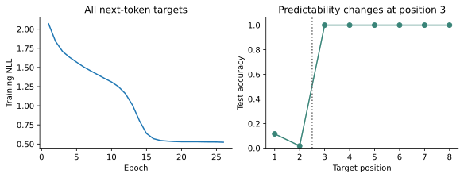

# Causal decoder and next-token prediction

A three-symbol motif repeats three times. Its first occurrences are hard to guess, but every later token has an exact match in the prefix.

A decoder-only transformer uses a causal self-attention mask. Loss is computed on every next-token prediction. At evaluation, the first two targets and the repeated targets are reported separately.

[Worked notebook](causal_decoder_and_next_token_prediction.ipynb) · [Python script](causal_decoder_and_next_token_prediction.py)

## Fit on disjoint motifs

The network sees eight prefix positions at a time. A strict upper-triangular mask prevents a position from seeing its own next-token target.

## Check the prefix and score greedy continuation

The held-out scores condition on the true prefix. Greedy continuation instead feeds the model its own predictions, starting from three observed symbols.

## Recorded output

```text
Exact six-token greedy continuation: 1.000 on 112 held-out motifs
```

## Results from the recorded run

| Target group | Tokens | Accuracy | NLL (nats) | Perplexity |
| --- | --- | --- | --- | --- |
| First occurrences | 224 | 0.06696 | 2.1730 | 8.78459 |
| Repeats | 672 | 1.00000 | 0.0054 | 1.00542 |

## Interpreting the result

All 112 unseen motifs continued correctly for six greedy steps after their three-symbol prefix. Next-token accuracy on the first two targets was only 6.7%. Averaging across those two types of target would conceal their different information content.

The position-wise curve distinguishes retrieval of a repeated motif from guessing the initial symbols. Exact continuation demands six consecutive correct decisions.



## Exercise

Change the motif length to four and extend the learned position table. Does the model still discover the correct lag?

## References

[Vaswani et al. (2017), Attention Is All You Need](https://arxiv.org/abs/1706.03762)

[Radford et al. (2018), Improving Language Understanding by Generative Pre-Training](https://cdn.openai.com/research-covers/language-unsupervised/language_understanding_paper.pdf)
