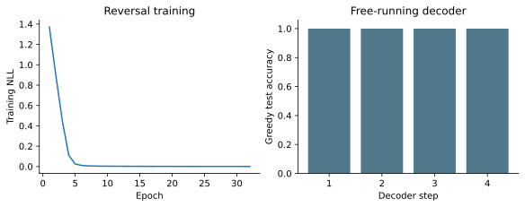

# Encoder-decoder sequence reversal

Reverse a four-symbol input one symbol at a time. A small encoder reads the whole source, while the decoder attends to the encoded source and its own prefix.

All outputs here have a fixed known length of four. Training supplies the correct preceding symbol. During greedy evaluation, the decoder receives its own previous prediction. The test set contains unseen source strings.

[Worked notebook](encoder_decoder_sequence_reversal.ipynb) · [Python script](encoder_decoder_sequence_reversal.py)

## Train with shifted targets

The start-of-sequence symbol has index five. The targets contain only the five data symbols.

## Decode unseen strings

Compare teacher-forced token accuracy with token and whole-string accuracy when the model must use its own output.

## Results from the recorded run

| Evaluation | Strings | Token accuracy | Exact string accuracy |
| --- | --- | --- | --- |
| Teacher forced | 145 | 1.0 | 1.0 |
| Greedy | 145 | 1.0 | 1.0 |

| Input | Expected | Greedy prediction |
| --- | --- | --- |
| 1 3 0 4 | 4 0 3 1 | 4 0 3 1 |
| 2 4 2 4 | 4 2 4 2 | 4 2 4 2 |
| 2 4 0 1 | 1 0 4 2 | 1 0 4 2 |
| 1 3 2 2 | 2 2 3 1 | 2 2 3 1 |

## Interpreting the result

All 145 unseen strings were reversed exactly under greedy decoding. The test uses four-symbol strings drawn from the same five-symbol alphabet as training. Longer inputs require a different position table and a separate test.

Exact-string accuracy is more demanding than token accuracy. If the two decoding protocols disagree, inspect the first wrong symbol and its effect on later positions.

## Exercise

Test the trained network on strings with repeated symbols only and compare its errors with those on the rest of the test set.

## References

[Vaswani et al. (2017), Attention Is All You Need](https://arxiv.org/abs/1706.03762)
