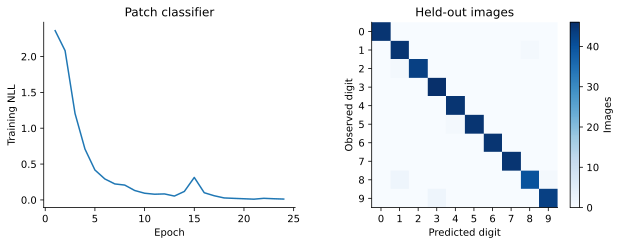

# Vision Transformer on handwritten digits

Cut each digit into sixteen patches and train a class token to classify the image. A confusion matrix shows which digits remain difficult at this resolution.

The images are the 8 × 8 optical digits bundled with scikit-learn. A learnable linear patch projection, positional embeddings, a class token and two self-attention blocks make a small Vision Transformer. The split is by image. Writer identities are unavailable.

[Worked notebook](vision_transformer_on_handwritten_digits.ipynb) · [Python script](vision_transformer_on_handwritten_digits.py)

## Train on the image split

Pixels are divided by their fixed maximum intensity of 16. Labels are used for supervised training and a stratified split.

## Inspect test errors

One held-out pass supplies class predictions, a confusion matrix and log loss. The flat-probability reference assigns each digit probability 0.1.

## Results from the recorded run

| Test images | Accuracy | Balanced accuracy | Macro F1 | Test NLL | Uniform NLL |
| --- | --- | --- | --- | --- | --- |
| 450 | 0.98222 | 0.98196 | 0.98214 | 0.06071 | 2.30259 |

## Interpreting the result

The model classified 442 of 450 held-out images correctly. Balanced accuracy was 0.982 and macro F1 was 0.982. Those scores concern an image-level split of the small optical digit images.

Errors away from the diagonal identify pairs worth inspecting in the original images. These scores describe small images and a single image-level split.

## Exercise

Replace the class token readout with a mean over encoded patches. Keep the split and optimiser settings fixed.

## References

[Dosovitskiy et al. (2021), An Image is Worth 16x16 Words](https://arxiv.org/abs/2010.11929)

[Alpaydin and Kaynak (1998), Optical Recognition of Handwritten Digits, UCI, CC BY 4.0](https://doi.org/10.24432/C50P49)
