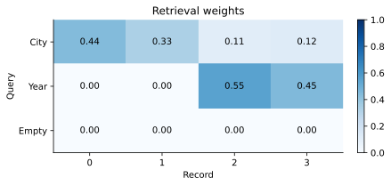

# Scaled dot-product and masked attention

Four library records contain a city or a year. A query retrieves a weighted average of the records it can see. One deliberately empty row makes the masking convention explicit.

Attention normalises QKᵀ/√d over allowed keys. Subtracting the largest finite logit stabilises the exponential. An empty query row returns zero attention and a zero output in this implementation.

[Worked notebook](scaled_dot_product_and_masked_attention.ipynb) · [Python script](scaled_dot_product_and_masked_attention.py)

## Inspect retrieval and masking

The third query has no available key. Modify a forbidden value and test that neither of the last two query outputs changes.

## Read the attention matrix

The values in each allowed row sum to one. A zero in the final row records an empty selection.

## Results from the recorded run

| Query | Allowed keys | Sum of weights | City output | Year output |
| --- | --- | --- | --- | --- |
| City | 4 | 1.0 | 0.69552 | 0.30448 |
| Year | 2 | 1.0 | 0.08943 | 0.91057 |
| Empty | 0 | 0.0 | 0.00000 | 0.00000 |

## Interpreting the result

The second query cannot read either city record. The perturbation test checks that restriction at the output, where a masking error would otherwise be easy to miss.

## Exercise

Double the query magnitudes and compare the entropy of the two non-empty rows.

## References

[Vaswani et al. (2017), Attention Is All You Need](https://arxiv.org/abs/1706.03762)
