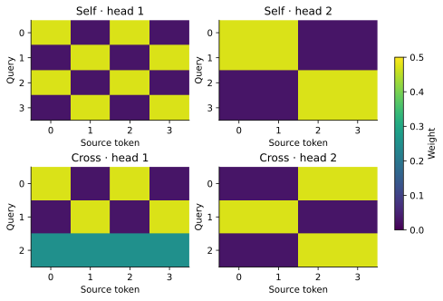

# Multi-head self-attention and cross-attention

A bilingual glossary contains a source token and a word class. Two heads can consult the same memory for different attributes.

In self-attention the queries and memory come from the same sequence. Cross-attention supplies queries from a second sequence, producing a rectangular matrix. Here the head projections select two known coordinate pairs, making each preference visible.

[Worked notebook](multi_head_self_attention_and_cross_attention.ipynb) · [Python script](multi_head_self_attention_and_cross_attention.py)

## Trace two queries through two heads

The source tokens have separate identity and class coordinates. The example uses identity output projection after concatenation.

## Compare square and rectangular attention

Rows denote queries and columns denote source tokens. Ties are expected because each coordinate pair is shared by two records.

## Results from the recorded run

| Head | Target query | First maximum key | Maximum weight | Entropy (nats) |
| --- | --- | --- | --- | --- |
| 1 | 1 | 1 | 0.4721 | 0.90842 |
| 1 | 2 | 2 | 0.4721 | 0.90842 |
| 1 | 3 | 1 | 0.2500 | 1.38629 |
| 2 | 1 | 3 | 0.4721 | 0.90842 |
| 2 | 2 | 1 | 0.4721 | 0.90842 |
| 2 | 3 | 3 | 0.4721 | 0.90842 |

## Interpreting the result

An attention head reads only the coordinates selected by its projections in this construction. Learnt projections can mix coordinates before the dot product.

## Exercise

Swap the target rows. Verify that the cross-attention output follows the permutation and that the self-attention map stays fixed.

## References

[Vaswani et al. (2017), Attention Is All You Need](https://arxiv.org/abs/1706.03762)
