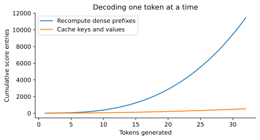

# Causal attention and the key-value cache

During generation, a decoder can store keys and values for earlier tokens. The cached calculation should reproduce a full causal pass at every prefix.

The cache below belongs to one attention layer. Each step projects only the new token and then attends to the full prefix. A second test changes the suffix and checks the earlier outputs.

[Worked notebook](causal_attention_and_the_key_value_cache.ipynb) · [Python script](causal_attention_and_the_key_value_cache.py)

## Compare the two decoding paths

Use a fresh prefix at every length. Count query-key dot products in one full-prefix recomputation per generation step and in incremental decoding.

## Count the work as the prefix grows

The dense reference computes square score matrices before masking. The incremental path uses one query for each generation step.

## Results from the recorded run

| Tokens | Full dense score entries | Cached score entries | Cache bytes | Max abs error |
| --- | --- | --- | --- | --- |
| 4 | 30 | 10 | 512 | 5.55e-16 |
| 8 | 204 | 36 | 1024 | 5.55e-16 |
| 16 | 1496 | 136 | 2048 | 1.55e-15 |
| 32 | 11440 | 528 | 4096 | 1.55e-15 |

## Interpreting the result

The cache stores two vectors per token in this single-head example. The table counts score entries, independent of hardware speed or memory bandwidth.

## Exercise

Switch the causal mask off in the full pass and see which prefix-equivalence tests fail.

## References

[Vaswani et al. (2017), Attention Is All You Need](https://arxiv.org/abs/1706.03762)

[Ainslie et al. (2023), GQA](https://arxiv.org/abs/2305.13245)
