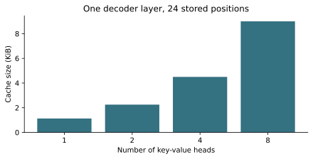

# Multi-query and grouped-query attention

Many decoder query heads can share fewer key and value heads. Grouping reduces the retained keys and values during autoregressive decoding.

The eight query heads use one, two, four or eight key-value heads. We compare an explicit repeated-array implementation with a grouped calculation on exactly the same tensors.

[Worked notebook](multi_query_and_grouped_query_attention.ipynb) · [Python script](multi_query_and_grouped_query_attention.py)

## Calculate grouped outputs

The group index maps each consecutive set of query heads to a single key-value head. Cache memory is calculated from the stored tensors themselves.

## Read the cache budget

Sequence length, query count, head width and precision stay fixed.

## Results from the recorded run

| KV heads | Queries per group | Stored KV bytes | Max abs error vs repeat |
| --- | --- | --- | --- |
| 1 | 8 | 1152 | 1.03e-07 |
| 2 | 4 | 2304 | 8.41e-08 |
| 4 | 2 | 4608 | 7.13e-08 |
| 8 | 1 | 9216 | 2.54e-07 |

## Interpreting the result

One key-value head gives multi-query attention and eight give ordinary multi-head attention. Agreement tests compare two implementations within each setting. Quality across settings would require training and evaluation.

## Exercise

Double the sequence length and predict the new cache sizes before running the experiment.

## References

[Ainslie et al. (2023), GQA](https://arxiv.org/abs/2305.13245)
