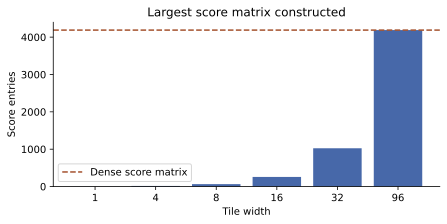

# Blockwise exact attention

A softmax can be accumulated without keeping a full matrix of attention scores. A running maximum is what makes the partial sums agree with dense attention.

This is the online normalisation calculation used in tiled exact attention. The NumPy example exposes its arithmetic and score-tile sizes. Hardware kernels, backpropagation and runtime benchmarking lie outside this experiment.

[Worked notebook](blockwise_exact_attention.ipynb) · [Python script](blockwise_exact_attention.py)

## Compare with a dense reference

Unequal query and key lengths and a partial final tile exercise two common indexing errors. A high logit scale tests numerical stability.

## Count temporary score entries

The dashed line is the whole dense score matrix. The estimate excludes Q, K, V, output arrays and the running sums.

## Results from the recorded run

| Tile width | Largest score tile (entries) | Max abs error vs dense |
| --- | --- | --- |
| 1 | 1 | 2.66e-15 |
| 4 | 16 | 1.78e-15 |
| 8 | 64 | 2.66e-15 |
| 16 | 256 | 1.78e-15 |
| 32 | 1024 | 1.33e-15 |
| 96 | 4189 | 2.22e-15 |

## Interpreting the result

The largest temporary score tile shrinks as the block size falls. Arithmetic still includes every query-key pair. A very small block also means more Python loop iterations.

## Exercise

Repeat with very large-magnitude logits and compare against a softmax that omits maximum subtraction.

## References

[Dao et al. (2022), FlashAttention](https://arxiv.org/abs/2205.14135)

[Vaswani et al. (2017), Attention Is All You Need](https://arxiv.org/abs/1706.03762)
