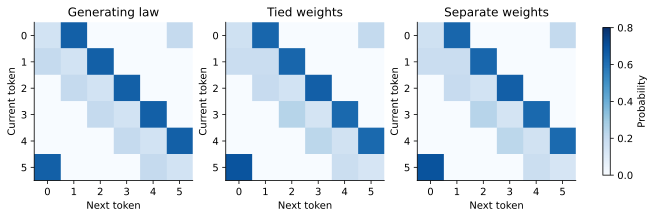

# Token embeddings and tied output weights

A language model can use one matrix both to look up tokens and to score the next token. Six symbols arranged on a ring give us a transition law we can check exactly.

Each symbol can stay, step clockwise or step anticlockwise. A learned projection between the lookup and the output gives a tied model room to learn asymmetric transitions. Both models see the same transition counts.

[Worked notebook](token_embeddings_and_tied_output_weights.ipynb) · [Python script](token_embeddings_and_tied_output_weights.py)

## Form a controlled next-token problem

Each row is an empirical distribution over the six possible successors. The independent test sample uses the same law.

## Fit the transition tables

Optimise multinomial cross-entropy on training counts. Test loss weights each observed transition by its frequency.

## Read a row of the fitted model

The bright off-diagonal band follows the clockwise successor. The colour scale is shared across panels.

## Results from the recorded run

| Output weights | Parameters | Test NLL (nats) | Perplexity |
| --- | --- | --- | --- |
| Tied | 55 | 0.87676 | 2.40309 |
| Separate | 85 | 0.87667 | 2.40287 |

## Interpreting the result

Tying the weights reduced the parameter count from 85 to 55. Both models produced test perplexity of about 2.40 on the independently sampled transitions.

The table counts unique trainable parameters. Reusing a tensor saves one vocabulary matrix. On a six-symbol task, held-out perplexity also depends on the finite sample of transitions.

## Exercise

Remove the projection and check which transition patterns a symmetric dot-product score can represent.

## References

[Vaswani et al. (2017), Attention Is All You Need](https://arxiv.org/abs/1706.03762)

[Inan, Khosravi and Socher (2017), Tying Word Vectors and Word Classifiers](https://arxiv.org/abs/1611.01462)
