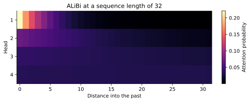

# ALiBi and attention distance

Attention with linear biases gives each causal head a different cost for looking further back. A neutral content score isolates what that bias does.

A head with positive slope m subtracts m times the distance from the logit of each allowed key. The four-head slope schedule follows the power-of-two construction used in ALiBi.

[Worked notebook](alibi_and_attention_distance.ipynb) · [Python script](alibi_and_attention_distance.py)

## Measure how far the heads look

Evaluate the final query at two lengths. The first and last columns of the heat map correspond to distances zero and 31.

## Read the distance preference

All four heads see the same flat content logits. The only difference between their distributions is the slope.

## Results from the recorded run

| Length | Head | Slope | Expected distance | Mass on nearest four |
| --- | --- | --- | --- | --- |
| 12 | 1 | 0.25000 | 2.89206 | 0.66524 |
| 12 | 2 | 0.06250 | 4.76215 | 0.41923 |
| 12 | 3 | 0.01562 | 5.31391 | 0.35437 |
| 12 | 4 | 0.00391 | 5.45345 | 0.33856 |
| 32 | 1 | 0.25000 | 3.51007 | 0.63233 |
| 32 | 2 | 0.06250 | 10.49664 | 0.25582 |
| 32 | 3 | 0.01562 | 14.17349 | 0.15398 |
| 32 | 4 | 0.00391 | 15.16708 | 0.13194 |

## Interpreting the result

A steep slope concentrates probability near the current token. A trained model adds learned content scores, so the slopes alone cannot predict its attention map.

## Exercise

Give a distant key a logit advantage of two. For which heads does it overtake the current token?

## References

[Press, Smith and Lewis (2022), Train Short, Test Long](https://arxiv.org/abs/2108.12409)
