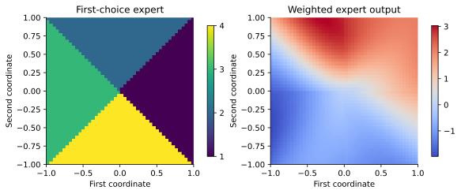

# Sparse top-two expert routing

Send a point to two of four small expert networks. Their gate probabilities determine how the two responses combine.

A router assigns four logits to each point of a grid. Softmax over the two selected logits gives a convex combination. Fixed router and expert weights make it possible to check a sparse dispatch against an independent dense calculation.

[Worked notebook](sparse_top_two_expert_routing.ipynb) · [Python script](sparse_top_two_expert_routing.py)

## Dispatch the grid

The dense check evaluates every expert and gives excluded experts zero weight. Points on an exact tie use the lower expert index.

## Locate the routing boundaries

The map on the left shows the first expert. The map on the right includes both selected experts, so it can change smoothly inside one routing region.

## Recorded output

```text
Expert evaluations for 2116 points: sparse 4232, dense 8464
```

## Results from the recorded run

| Expert | First choice | Either choice | Total gate weight |
| --- | --- | --- | --- |
| 1 | 552 | 1058 | 529.0 |
| 2 | 529 | 1058 | 529.0 |
| 3 | 529 | 1058 | 529.0 |
| 4 | 506 | 1058 | 529.0 |

## Interpreting the result

Each point appears twice in the assignment count. Gate mass is different: its sum across experts equals the number of points. Both quantities matter when interpreting routing.



## Exercise

Add a constant to every router logit and check whether the selected experts or outputs change.

## References

[Shazeer et al. (2017), Outrageously Large Neural Networks](https://arxiv.org/abs/1701.06538)
